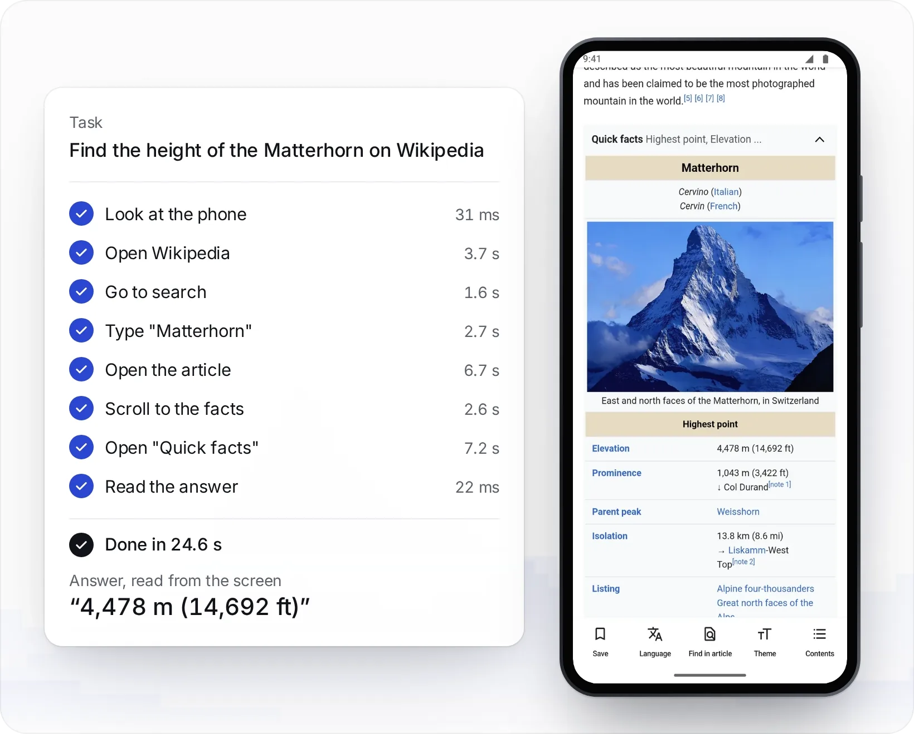
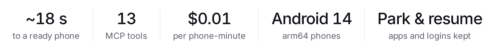
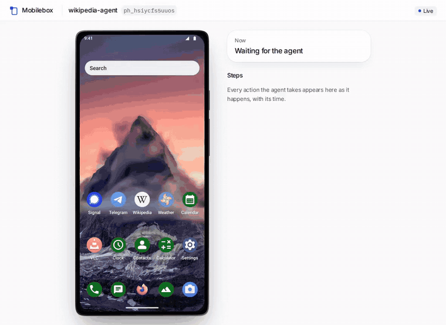

<a href="https://mobilebox.dev/?via=readme">
  <picture>
    <source media="(prefers-color-scheme: dark)" srcset=".github/readme/banner-dark.png">
    
  </picture>
</a>

<p align="center"><b>Cloud Android phones for AI agents, over MCP and REST. $0.01 a minute.</b></p>

**Mobilebox gives your AI agent a phone it can use.** Claude Code, Codex, Cursor or your own agent loop creates a cloud Android 14 phone, reads the screen as numbered elements, taps, types, installs your APK, then parks or deletes the phone. One phone per task or pull request costs a few cents: $0.01 per phone-minute, billed per second.

- **Measured, 2026-11-08** ([method, scripts and CSV](benchmarks)): a Mobilebox phone was ready for its first screenshot in 19.4 s (median of 10) and a 10-minute session cost $0.10. On a GitHub Actions runner, the same start took 20.3 s, against 50 s for the Android emulator with KVM and 813 s without it (one run).
- **Fair comparison:** in the same benchmark Limrun started in 0.98 s ($0.04 a minute on its $20 plan), and Clousd lists a lower price ($0.004 a minute, as published on 2026-11-10). [All cloud phones for AI agents, compared](https://mobilebox.dev/blog/best-cloud-phones-for-ai-agents?via=readme).

<p align="center">
  <a href="https://mobilebox.dev/?via=readme">Website</a> ·
  <a href="https://mobilebox.dev/docs?via=readme">Docs</a> ·
  <a href="#quickstart">Quickstart</a> ·
  <a href="https://registry.modelcontextprotocol.io/v0/servers?search=dev.mobilebox/mobilebox">MCP registry</a>
</p>

<p align="center">
  <a href="https://github.com/fifteenA/mobilebox/actions/workflows/ci.yml"></a>
  <a href="https://glama.ai/mcp/connectors/dev.mobilebox/mobilebox"></a>
  <a href="https://registry.modelcontextprotocol.io/v0/servers?search=dev.mobilebox/mobilebox"></a>
  <a href="https://www.npmjs.com/package/mobilebox"></a>
  <a href="https://mcpservers.org/servers/fifteena/mobilebox"></a>
  <a href="https://github.com/fifteenA/android-smoke-action"></a>
  <a href="LICENSE"></a>
</p>

<p align="center">
  <a href="https://cursor.com/install-mcp?name=mobilebox&config=eyJ1cmwiOiJodHRwczovL21vYmlsZWJveC5kZXYvbWNwIn0%3D"><picture><source media="(prefers-color-scheme: dark)" srcset="https://cursor.com/deeplink/mcp-install-light.svg"></picture></a>
  <a href="https://insiders.vscode.dev/redirect/mcp/install?name=mobilebox&inputs=%5B%7B%22id%22%3A%22mobilebox_key%22%2C%22type%22%3A%22promptString%22%2C%22description%22%3A%22Mobilebox%20API%20key%22%2C%22password%22%3Atrue%7D%5D&config=%7B%22type%22%3A%22http%22%2C%22url%22%3A%22https%3A%2F%2Fmobilebox.dev%2Fmcp%22%2C%22headers%22%3A%7B%22Authorization%22%3A%22Bearer%20%24%7Binput%3Amobilebox_key%7D%22%7D%7D"></a>
</p>

<p align="center">
  <picture>
    <source media="(prefers-color-scheme: dark)" srcset=".github/readme/demo-dark.webp">
    
  </picture>
  <br><sub>Phone screens are unedited API screenshots from one recorded run; steps and times are its MCP calls, from the home screen on. Playback shortened.</sub>
</p>

<p align="center">
  <picture>
    <source media="(max-width: 600px) and (prefers-color-scheme: dark)" srcset=".github/readme/stats-dark-narrow.png">
    <source media="(max-width: 600px)" srcset=".github/readme/stats-light-narrow.png">
    <source media="(prefers-color-scheme: dark)" srcset=".github/readme/stats-dark.png">
    
  </picture>
  <br><sub>Ready time: create to ready, three runs on 2026-11-04 (<a href="examples/RUNS.md">RUNS.md</a>).</sub>
</p>

<p align="center">Works with &nbsp;
  &nbsp;Claude&nbsp;Code &nbsp;
  &nbsp;Codex &nbsp;
  &nbsp;Cursor &nbsp;
  &nbsp;any&nbsp;MCP&nbsp;client
</p>

- **Listed** in the [official MCP registry](https://registry.modelcontextprotocol.io/v0/servers?search=dev.mobilebox/mobilebox) as `dev.mobilebox/mobilebox`, tool definitions rated **A** on [Glama](https://glama.ai/mcp/connectors/dev.mobilebox/mobilebox).
- **Checked on every deploy:** an end-to-end run on production that uses only the public docs (create, install, tap, type, park, resume, delete over REST and MCP).

## Quickstart

**1. Get a key.** [Sign up with GitHub](https://mobilebox.dev/signup?via=readme) ($2 of credit, 200 phone-minutes) and create an agent key in the [dashboard](https://mobilebox.dev/dashboard?via=readme).

```bash
export MOBILESANDBOX_API_KEY=...   # keep it in your shell or secret manager, never in a prompt
```

**2. Add Mobilebox to your agent.**

```bash
claude mcp add --transport http mobilebox https://mobilebox.dev/mcp \
  --header "Authorization: Bearer $MOBILESANDBOX_API_KEY"
```

<details>
<summary>Codex, Cursor, a shared <code>.mcp.json</code>, other clients</summary>

**Codex**, `~/.codex/config.toml`:

```toml
[mcp_servers.mobilebox]
url = "https://mobilebox.dev/mcp"
bearer_token_env_var = "MOBILESANDBOX_API_KEY"
```

**Cursor**: the **Add to Cursor** button above installs the URL alone and Cursor signs you in over OAuth, no key. Or `.cursor/mcp.json` with the key:

```json
{ "mcpServers": { "mobilebox": { "url": "https://mobilebox.dev/mcp", "headers": { "Authorization": "Bearer ${env:MOBILESANDBOX_API_KEY}" } } } }
```

**Claude Code, shared through a committed `.mcp.json`** without the key in it. Keep `"type": "http"`, or Claude Code treats the entry as a stdio server:

```json
{ "mcpServers": { "mobilebox": { "type": "http", "url": "https://mobilebox.dev/mcp", "headers": { "Authorization": "Bearer ${MOBILESANDBOX_API_KEY}" } } } }
```

**Other clients:** any MCP client with Streamable HTTP and a custom header. Hand-written clients also send `Accept: application/json, text/event-stream`. The registry entry is [`server.json`](server.json).
</details>

**3. Give it a task.**

> Use Mobilebox. Create a phone, open Settings and tell me which Android version it runs. Delete the phone at the end, even if a step fails.

Next: let your agent [test the APK you just built](examples/claude-code), or run the same check [in CI](examples/github-actions). No MCP client? [curl/walkthrough.sh](examples/curl/walkthrough.sh) does the whole loop over REST ([OpenAPI](https://mobilebox.dev/openapi.json?via=readme), [reference](https://mobilebox.dev/docs/reference?via=readme)).

## Watch your agent

<p align="center">
  
  <br><sub>A real agent on a Mobilebox phone, recorded in the live view at real speed. One step fails, and the log says why.</sub>
</p>

Open a live view of any running phone and see every step as it happens: a cursor that moves to each target, a ripple for every tap, a trail for every swipe, the text as it is typed (dots in password fields), and a caption with its time for each step. Nothing depends on sound, and screen readers announce each caption.

```bash
npx mobilebox watch <phone_id>   # with MOBILESANDBOX_API_KEY set: opens the view in its own window
```

Over MCP, ask your agent to show you the phone: `watch_phone` returns the link (REST: `POST /v1/phones/{id}/view`). The dashboard has a Watch button on every running phone. The view is read-only and watching is free. Try it with [watch/watch.sh](examples/watch/watch.sh); details in the [API reference](https://mobilebox.dev/docs/reference?via=readme#watch-live).

## Tools

Phones, apps and the screen over MCP; REST adds binary APK upload, account balance and billed sessions. Sign in once with OAuth from any MCP client that supports it (Claude, ChatGPT, Cursor, VS Code): add `https://mobilebox.dev/mcp` and approve. Or send your key as `Authorization: Bearer`.

<details>
<summary>All tools and actions (generated from the live <code>tools/list</code>; CI fails when it drifts)</summary>

<!-- tools:start (generated by scripts/check-mcp.mjs --write) -->
| Tool | What it does | Arguments (`?` = optional) |
|---|---|---|
| `list_phones` | List this project's phones. | – |
| `create_phone` | Create a phone and wait until it is ready. | `platform?`, `device?`, `name?`, `idle_timeout?`, `max_duration?`, `country?`, `city?`, `network?`, `idempotency_key?`, `task?` |
| `start_phone` | Resume a parked phone and wait until it is ready; its apps, data and logins are kept. | `phone_id` |
| `park_phone` | Park a phone: shuts it down and stops billing. | `phone_id` |
| `delete_phone` | Delete a phone and everything on it: apps, data and logins. | `phone_id` |
| `set_device` | Set where the phone is: country and city together, or timezone, locale and GPS one by one, plus the network its IP comes from or a proxy. | `phone_id`, `timezone?`, `locale?`, `location?`, `proxy?`, `country?`, `city?`, `network?` |
| `install_app` | Install or update an app from a public download URL: an APK (arm64-v8a or universal) or a split bundle (.apks/.xapk; the splits this phone needs are picked). | `phone_id`, `url`, `grant_permissions?` |
| `list_apps` | List the apps the user installed on this phone, not the system apps. | `phone_id` |
| `uninstall_app` | Uninstall an app and delete its data. | `phone_id`, `package` |
| `observe` | Read the current screen as a numbered element list. | `phone_id` |
| `act` | Run 1–20 actions on the phone in order (tap, type, swipe, scroll, keys, open or close apps, waits) and stop at the first failure. | `phone_id`, `actions` |
| `screenshot` | Take a screenshot of the phone. | `phone_id` |
| `watch_phone` | Get a link to watch the phone live, for the user: its screen with each of your actions drawn on it (cursor, taps, swipes, typed text) and a caption per step. | `phone_id` |
| `publish_proof` | Publish this run's proof for a pull request: returns Markdown to post as the PR comment (passed or failed, duration and cost from the phone's session, up to 3 screenshots) and the screenshot URLs. | `phone_id`, `title`, `status`, `screenshots?`, `idempotency_key?` |
| `request_capability` | Tell Mobilebox about something you needed and we don't offer yet; it's recorded and answered by the team. | `what`, `why?` |
<!-- tools:end -->

Actions for `act`: `tap`, `long_press`, `swipe`, `scroll`, `scroll_to`, `type`, `key`, `back`, `home`, `open_app`, `close_app`, `wait`, `wait_for`. Targets: `{"text":"OK"}` (best default), `{"ref":3}`, `{"id":"com.app:id/login"}`, `{"desc":"Navigate up"}`, `{"x":540,"y":1200}`. REST only: `POST /v1/phones/{id}/apps` (APK upload), `GET /v1/account`, `GET /v1/phones/{id}/sessions`. Full vocabulary: [API reference](https://mobilebox.dev/docs/reference?via=readme).
</details>

## Examples

Each creates a phone, checks one outcome and deletes the phone, also when the check fails. All ran against production: on 2026-11-04, and the live view example on 2026-11-05 ([RUNS.md](examples/RUNS.md)).

| Example | Shows | Needs |
|---|---|---|
| [curl/walkthrough.sh](examples/curl/walkthrough.sh) | create, observe, act, screenshot, delete | bash, curl, jq |
| [watch/watch.sh](examples/watch/watch.sh) | open the live view, then act while you watch | bash, curl, jq; Node for `npx mobilebox` |
| [python/mobilebox.py](examples/python/mobilebox.py) | minimal client + Settings check | Python 3.9+, stdlib |
| [typescript/mobilebox.ts](examples/typescript/mobilebox.ts) | minimal client + Settings check | Node 24 |
| [claude-code/](examples/claude-code) | Claude Code tests the APK you just built | an arm64 or universal APK |
| [github-actions/](examples/github-actions) | APK smoke test in a workflow | a repo secret with your key |
| [packages/python/](packages/python) | `mobilebox` Python client and `langchain-mobilebox` LangChain tools | Python 3.10+ |
| [integrations/](examples/integrations) | OpenAI Agents SDK, LangGraph, CrewAI, browser-use, Mastra, Vercel AI SDK, Claude Agent SDK | the framework and a model key |

## Pricing

| Device | Price |
|---|---|
| Cloud Android 14 phone (arm64) | $0.01 per phone-minute |
| iPhone and iPad (`platform: "ios"`) | $0.05 per phone-minute |
| Real Android device (`device: "real"`) | $0.03 per phone-minute |
| Dedicated devices | from $79 per month |

Billed per second while a phone is ready, with a one-minute minimum per session. Boot time and parked phones are free. New accounts start with $2 of credit; add more from the dashboard. Over 100 devices: [contact sales](https://calendly.com/mustafa-yenler/30min). [Pricing](https://mobilebox.dev/pricing?via=readme).

<details>
<summary>Requests and sessions</summary>

- Up to 20 actions per `act` call, 256 KB of JSON per request, waits up to 55 s per call, APK uploads up to 300 MiB.
- Phones park after 5 idle minutes (`idle_timeout`, 60–3,600 s) and after 15 minutes of running (`max_duration`, up to 3 hours).
- All keys of a workspace (called *project* in the API) share its phones and balance.
- Apps with strict root or integrity checks (e.g. Play Integrity) may not run on a cloud phone; use a real Android device for those.
</details>

## Security

Each phone is an isolated Android sandbox on Mobilebox servers in Germany, reachable only through the API. Keys are per workspace, stored hashed and never logged. Mobilebox runs no model: screen content goes only to your agent.

<details>
<summary>Security model</summary>

- **Your key is a bearer token for one workspace.** Every key in a workspace can see and control all of its phones and spend its balance. For a hard boundary between two agents or customers, use separate workspaces, not separate keys.
- **Agent keys only control phones.** They cannot sign into the dashboard or create other keys. Revoke or rotate keys in the dashboard.
- **The phone is a sandbox, not your machine.** Each phone is a cloud Android 14 phone on Mobilebox servers in Nuremberg, Germany. There is no public ADB or shell. Phones can reach the internet (or the SOCKS5 proxy you set) but not each other or Mobilebox's internal network.
- **Screen content goes to your agent, and from there to its model provider.** Don't put data on a phone that you aren't allowed to send to your agent's model.
- **We don't look into phones** except to fix a fault you report or when the law requires it. Park keeps apps, data and logins; delete removes them. Deleting a phone does not log out sessions on third-party servers.
- Details: [privacy policy](https://mobilebox.dev/privacy?via=readme), [key security](https://mobilebox.dev/blog/android-api-key-security?via=readme). Found a vulnerability? See [SECURITY.md](SECURITY.md).
</details>

## For agents

[AGENTS.md](AGENTS.md) is the operating guide: the loop, targets, error recovery and cleanup. Live versions: [skill.md](https://mobilebox.dev/skill.md?via=readme), [llms.txt](https://mobilebox.dev/llms.txt?via=readme).

---

Questions: hello@mobilebox.dev, or [open an issue](../../issues). [MIT](LICENSE) for this repository; the hosted service is covered by its [terms](https://mobilebox.dev/terms?via=readme).
